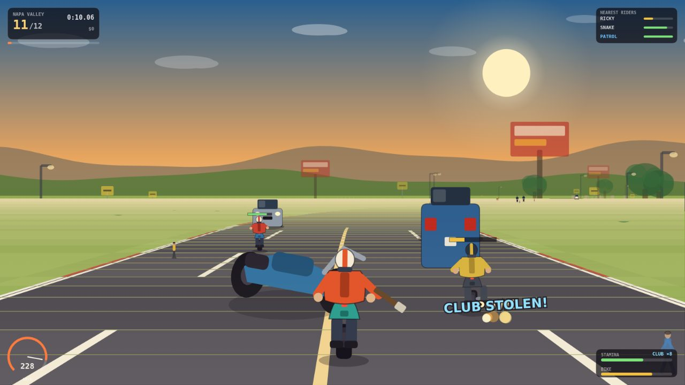

# Road Rash — browser tribute

A from-scratch, non-commercial tribute to **Road Rash (Electronic Arts, 1991)**:
pseudo-3D motorcycle racing down California highways, with punches, kicks,
traffic, livestock, pedestrians and the occasional body lying in your lane.

Everything you see and hear is generated at runtime — every sprite is drawn
with canvas primitives and every sound is synthesised with WebAudio. No game
engine, no framework, no sprite sheets: `index.html`, one CSS file and seven
small ES modules.



- **Play:** `/roadrash` (or `/roadrash/index.html` on its own)
- **Not affiliated with EA.** Road Rash is a trademark of its respective owner;
  this is a fan project built for study, with original art and audio.

---

## Controls

| Action | Keyboard | Touch / gamepad |
| --- | --- | --- |
| Throttle | `W` / `↑` | `GAS` (RT) |
| Brake | `S` / `↓` | `BRAKE` (LT) |
| Steer | `A` / `D` / `←` / `→` | `◀` `▶` (left stick) |
| Punch / swing club | `J` / `Z` / `Space` | `PUNCH` (X) |
| Kick | `K` / `X` | `KICK` (B) |
| Pause | `P` / `Esc` | `❚❚` button |
| Music on/off | `M` | `♪` button |

## What the 1991 game actually did (and what this version does)

The original is remembered for four things. All four are here:

| 1991 mechanic | In this build |
| --- | --- |
| **Riding alongside someone and punching / kicking them** — every rider has a stamina bar; empty it and they eat asphalt | Auto-aimed melee: the closest rider alongside you is hit. Punch (fast, less damage) vs. kick (slower, more damage + shove). Emptying a rival's stamina knocks them off — you take their place. Rival stamina bars float above them and are listed in the HUD. |
| **Weapons** — riders carry clubs; time a punch as they swing and you steal it | Rivals from level 2 can carry clubs. Punch one mid-swing and you take it: 8 heavy swings that also fling the victim sideways. A club lying in the road can be picked up mid-race. |
| **Hitting pedestrians / riders who already fell** — they get flung, and *you* don't crash | Pedestrians wander onto the road. Hit one and they tumble away while you lose a little speed and a sliver of bike condition. |
| **A bike lying in your lane bounces you** | Loose bikes and bodies in the road are physical: ride over one and you get the **BUMP** — a hard recirculation of your speed, a wobble, and a kick of camera shake. At high speed that wobble is what throws you into the next car. |

Also carried over:

- **Wipeouts, not respawns.** Crash and you tumble, then sprint back to the bike
  on foot (the "RUN BACK TO THE BIKE" beat) before remounting — the field keeps
  going without you.
- **Bike damage.** Every spill eats condition. Wreck it completely and the
  engine starts smoking and the top speed collapses.
- **Traffic in both directions**, oil slicks, cows, deer, and roadside scenery
  that ends your day if you take the shoulder too wide.
- **Cops** (level 2+). Patrol riders shadow you; if they reach you while you're
  still tangled in a wreck, you're **BUSTED** and fined.
- **Top-4 to advance**, prize money, and a **garage** where winnings buy a
  faster machine.
- **Five California circuits** in the spirit of the originals: Grass Valley,
  Sierra Nevada, Napa Valley, Pacific Coast, Palm Desert.

Deliberate differences: no licensed bikes or riders, no password screen, and
the art direction is flat vector rather than 16-bit sprites.

## How the pseudo-3D road works

This is a 1991 technique, not a 3D engine:

1. The highway is a flat list of **segments** (`road.js`). Each one stores a
   curve amount, an elevation, and the roadside props standing on it.
2. Every frame, the segments in front of the camera are **projected** to screen
   space, near to far, with the classic `scale = cameraDepth / cameraZ`
   perspective divide. Curves are faked by accumulating a horizontal offset per
   segment; hills come from the projected `y`.
3. Segments are painted back-to-front with a painter's algorithm, then every
   prop, car, rider and body is drawn at its segment's projected position, using
   a clamped clip line so nothing pokes through a hill.
4. Riders and other characters shrink with an **exaggerated** perspective curve
   (`charScale` in `render.js`) — pixel-accurate scaling makes riders two pixels
   tall at 200 km/h and unreadable; the original did the same cheat.

The road, riders, vehicles, animals and props are all drawn with canvas 2D
primitives (`art.js`). The engine noise, punches, crashes, sirens and the
looping 16-bit bassline are synthesised with WebAudio (`audio.js`).

## Files

```
public/roadrash/
  index.html      menus, garage, results, touch controls
  style.css       UI chrome (the game itself is canvas)
  js/util.js      math helpers, seeded RNG, formatting
  js/road.js      track generation, themes, perspective projection
  js/game.js      rules: throttle, cornering, brawling, traffic, AI, crashes
  js/art.js       every sprite, hand-drawn with 2D primitives
  js/render.js    renderer (road, sprites, sprite scaling) + HUD
  js/audio.js     WebAudio SFX + procedural music
  js/main.js      DOM wiring, input, save data, main loop
```

Tuning knobs live at the top of `game.js` (bike stats, rival names, palettes)
and in `road.js` (`LEVELS` for length/rivals/traffic, `THEMES` for the look).

## No database, no build step

The whole game is client-side. The only persistence is `localStorage`
(cash, best bike, unlocked circuit, sound preference) under
`roadrash-tribute-v1`. The Next.js app in this repository only hosts the static
files through `/roadrash/index.html`; open that file from any static server and
it runs identically.

## Performance notes

- Segments shorter than a few pixels are painted as a single flat quad
  (`drawSegment`), which is most of the draw list at distance.
- The canvas backing store is capped at `devicePixelRatio ≤ 1.5`.
- Fog, palette and gradient work is cached per theme and quantised into 16
  steps, so the renderer does no string colour maths in the hot loop.

A 1280×720 frame (update + full render, all sprites) measures ~8 ms in a native
canvas benchmark, i.e. comfortably above 60 fps on a desktop CPU.
